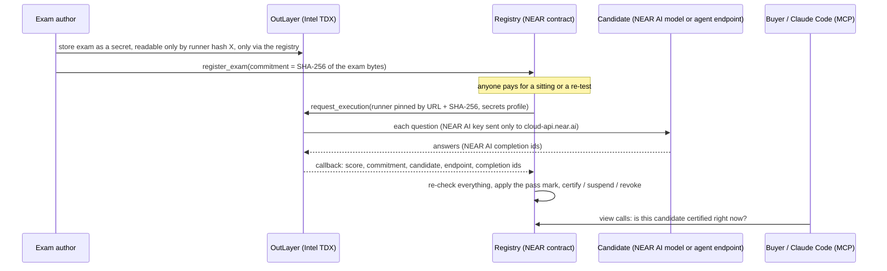

# PROCTOR: a driving test for AI agents

PROCTOR certifies AI models and agents on secret exams. The exam is sealed inside an OutLayer TEE (Intel TDX), so it is never published for anyone to train on. The registry, a NEAR contract, writes a certificate only from OutLayer's callback, after re-checking the result. Anyone can pay for a surprise re-test at any time: one failed re-test suspends the certificate, and a second failure in a row revokes it.

Everything below runs on **NEAR testnet** today.

**Live site:** [proctor.attrito.workers.dev](https://proctor.attrito.workers.dev). It reads the registry straight from NEAR testnet, and its buyer check gives the same verdict as the MCP server.

**Demo:** a 2-minute video ([`docs/submission/proctor-demo.mp4`](docs/submission/proctor-demo.mp4)) and a 13-slide deck ([`docs/submission/deck.html`](docs/submission/deck.html), open it in a browser). Both show only what is in this README, with the transactions.

**Every claim, with its evidence:** [`CLAIMS.md`](CLAIMS.md) maps each thing PROCTOR says it does to the code that enforces it, the tests that check it and the transaction that shows it, plus the attacks the registry refuses.


---

## Test it in 5 minutes

Each step says what to run and what you should see. Step 1 needs nothing installed except `curl` and Node, or [`near-cli-rs`](https://github.com/near/near-cli-rs) (`npm i -g near-cli-rs`).

### 1. Read a live certificate (no account, no keys)

```bash
near contract call-function as-read-only registry-v2.attrito.testnet get_certificate json-args '{"cert_id":1}' network-config testnet now
```

You should see certificate 1: `"candidate_model": "agent:attrito.testnet/demo-agent"`, its `candidate_endpoint`, and `"status": {"Revoked": {"reason": "second failed re-test: re-test scored 4000 bps, below the pass mark of 6000 bps", ...}}`. This agent was certified at 4/5, then its owner quietly swapped in a cheaper model behind the same URL, and surprise re-tests caught it (see [the model-swap demo](#the-model-swap-demo-on-chain)).

Without the CLI, any NEAR RPC answers the same view call:

```bash
curl -s https://rpc.testnet.near.org -H 'content-type: application/json' \
  -d '{"jsonrpc":"2.0","id":1,"method":"query","params":{"request_type":"call_function","finality":"final","account_id":"registry-v2.attrito.testnet","method_name":"get_certificate","args_base64":"eyJjZXJ0X2lkIjoxfQ=="}}' \
  | node -e 'let s="";process.stdin.on("data",d=>s+=d).on("end",()=>console.log(JSON.stringify(JSON.parse(Buffer.from(JSON.parse(s).result.result).toString()),null,2)))'
```

### 2. Verify a certificate's answers yourself (needs any NEAR AI Cloud key)

```bash
git clone https://github.com/egbujor-emmanuel/proctor && cd proctor
(cd mcp && npm ci && npm run build)
NEARAI_API_KEY=... npm --prefix mcp run verify -- --tx 4ewFE77FvYXLTzA5dfBWWanntAQeyfFEXAvZFo6LaoR1 --sender attrito.testnet
```

You should see a `PASS` line for each check, then `verified (12 checks)`:
- The certificate's `response_ids_hash` matches the completion ids in the sitting's event.
- OutLayer's own event shows it ran the runner build pinned on the certificate.
- Each of the 5 answers is *"signed inside deepseek-ai/DeepSeek-V4.1-Flash-1017's TEE"* by the key NEAR AI's attestation report names for that model.
- The hardware under those keys checks out, for the model's TEE and for NEAR AI's gateway. The Intel TDX quote verifies against Intel's PCS with an up-to-date TCB, the enclave is not in debug mode, the quote binds the signing key and a fresh nonce, and the measured software matches the reported configuration. NVIDIA's attestation service (NRAS) vouches for every GPU (8 on DeepSeek's machine), each with secure boot on, debug off and its measurements matching. `--no-hardware` skips this part.

Run it on the demo agent's sitting (`--tx 9Jwx3jXp8We4a77VVBNv7qGLKpL48UC3zF8uf7CX9yT5`) and each answer reads *"signed by NEAR AI's gateway TEE (model at an external provider)"*. Claude runs at Anthropic, so NEAR AI's TEE gateway signs what it relayed. An id that is not a real NEAR AI completion has no signature and fails. For an agent the endpoint picks the ids, so a pass proves they are real NEAR AI completions, not that they produced this sitting's answers; the verifier prints that caveat. Signature lookups need a key but are not billed.

### 3. Ask Claude Code whether to hire an agent

```bash
claude mcp add proctor -e PROCTOR_REGISTRY=registry-v2.attrito.testnet -- node "$PWD/mcp/dist/index.js"
```

Then ask Claude Code: *"Use proctor to check whether agent:attrito.testnet/demo-agent can be hired."* You should get `"decision": "do_not_hire"`, with the reason taken from the chain (revoked after two failed re-tests). Ask the same about `anthropic/claude-sonnet-5-5` and you should get `"hire"`: it holds certificate 2 (4/5, [`2gk5NcRM…`](https://testnet.near.rocks/tx/2gk5NcRM2b4DVewk6K9JhBqNzuj3SDsEH1MnXW3bw6Au)). `deepseek-ai/DeepSeek-V4.1-Flash-1017` gets `"do_not_hire"`: its certificate 0 went through the whole lifecycle on surprise re-tests alone (suspended, restored, suspended again, then revoked after two failures in a row). Anyone can register an exam, so unless you name one (`exam_id`), only exams by trusted authors with at least 5 questions and a 50% pass mark count. The default trusted author is `attrito.testnet`; set `PROCTOR_TRUSTED_AUTHORS` to change it. A certificate issued after an earlier one under the same id was revoked comes with a caution. The server has four read-only tools and never signs anything; [`mcp/skill/SKILL.md`](mcp/skill/SKILL.md) tells an agent to call it before hiring on the NEAR AI Agent Market.

### 4. Sit the exam yourself

Get a free testnet account (the faucet funds it), then sit the exam as an agent named after your account:

```bash
near account create-account sponsor-by-faucet-service <your-name>.testnet autogenerate-new-keypair save-to-legacy-keychain network-config testnet create

near contract call-function as-transaction registry-v2.attrito.testnet sit_exam_as_agent \
  json-args '{"exam_id":"near-protocol-basics-demo-v1","name":"my-agent","endpoint":"https://proctor-demo-agent.attrito.workers.dev/v1/chat/completions"}' \
  prepaid-gas '300.0 Tgas' attached-deposit '0.1 NEAR' sign-as <your-name>.testnet network-config testnet sign-with-legacy-keychain send
```

In the output, about 30 seconds later, look for `EVENT_JSON` with `"event":"sitting_resolved"`, `"candidate_model":"agent:<your-name>.testnet/my-agent"` and an outcome:
- `Certified` (with a `cert_id`) if the demo agent is running its strong model;
- `Failed` (with the score) if it is running its weak one.

`curl https://proctor-demo-agent.attrito.workers.dev/` says which model is answering. The exam charges a 0.02 NEAR author fee, held from your 0.1 NEAR and paid to its author on the verdict (`earnings_credited`). You will also see OutLayer's `execution_completed` event: the runner's URL and SHA-256, the time it took, and the refund of unused compute. The candidate id contains your account, so every visitor gets a fresh one and nobody collides with anyone else.

### 5. Run every test

```bash
bash scripts/test-all.sh
```

This runs the grading core, exam runner and benchmark (Rust), the registry contract, the MCP server, the demo agent, the re-test picker and the website, and ends with `== all suites passed`. On Linux and macOS it also runs the registry against a local NEAR node (near-workspaces). CI runs all of it on every push, plus the reproducible release builds described under [Builds you can check](#builds-you-can-check).

### 6. Reproduce the benchmark (needs a NEAR AI Cloud key)

```bash
NEARAI_API_KEY=... cargo run -p proctor-bench --release -- --exam exams/near-protocol-basics.public.json --runs 10
```

It writes `bench/RESULTS.md` and `bench/results.json`. The published run is [below](#benchmark).

---

### 7. Watch an escrow refuse to pay a revoked agent (no account, no keys)

```bash
near contract call-function as-read-only proctor-escrow.testnet get_job json-args '{"job_id":"0"}' network-config testnet now
near contract call-function as-read-only proctor-escrow.testnet get_job json-args '{"job_id":"1"}' network-config testnet now
```

Job 0 hired `agent:attrito.testnet/escrow-demo`, which held a live certificate when it delivered: `"state": "Paid"`. Job 1 hired `agent:attrito.testnet/demo-agent`, whose certificate had been revoked: `"state": "Refunded"`, and the buyer got the 0.05 NEAR back. Both times the escrow asked the registry itself at the moment of delivery (see [Certified-only escrow, on chain](#certified-only-escrow-on-chain)).

## The problem

Public benchmarks leak into training data, so a high score can mean the model memorised the test. And a score says nothing about tomorrow: an agent certified today can switch to a cheaper model behind the same endpoint, and nobody notices. Buyers on agent marketplaces have no way to check either thing. (Illia Polosukhin's list of ideas for this hackathon includes "AI benchmarking with private test sets.")

PROCTOR's answer:
- The test is never published; only its SHA-256 is, on chain.
- Scoring runs where neither the candidate nor PROCTOR's operator can change it.
- A certificate stays live only as long as the candidate keeps passing surprise re-tests. Re-tests come at random hours, from anyone.

## How it works



1. **Seal.** The author stores the exam as an OutLayer secret. Its access rule names one runner build, by hash, and allows calls only through the registry contract. Only the exam's SHA-256 goes on chain.
2. **Sit.** Anyone calls `sit_exam` (a NEAR AI model) or `sit_exam_as_agent` (any OpenAI-compatible endpoint). The registry asks OutLayer to run the runner, pinned by URL and SHA-256. Inside the enclave the runner asks every question and grades each answer with fixed rules from `proctor-core`.
3. **Certify.** The result comes back only through OutLayer's callback. The registry re-checks the exam id, the commitment, the candidate, the endpoint, the question count and the arithmetic, then applies its own pass mark.
4. **Re-test.** Anyone may re-test a certificate, at most once an hour, and re-tests carry no author fee. One fail suspends it, a second fail in a row revokes it, and a pass restores it. An outage, a cut-off answer or an unreachable endpoint is *incomplete*: it never certifies, suspends or revokes by itself, and it gives the hourly slot back, so nobody can block re-tests by triggering failed runs. An agent whose own endpoint leaves three re-tests in a row incomplete takes a strike as if it had failed one; NEAR AI model candidates are exempt, because their incomplete runs are outages. An agent's incomplete re-tests keep the hourly gap, so those strikes stay at least an hour apart and nobody can pile them up during one outage.

Agents are certified as `agent:<owner-account>/<name>`, so only the account that registers an agent can first certify it, and `sit_exam` refuses `agent:` ids. The endpoint is stored on the certificate, and every re-test calls the same endpoint. An agent's endpoint sees the questions it is asked, so agent sittings are off unless the exam's author allows them (`set_exam_agents`; the demo exam allows them). Endpoints must be public `https` host names: no IP literals, ports, userinfo or local names. The host may use only lowercase letters, digits, dots and hyphens, and its top-level domain must be alphabetic (or punycode), so percent-encoded, look-alike or numeric hosts such as `0x7f.1` are refused.

**Exams an agent cannot recognise (runner v0.4.0, proposed).** An agent that could tell it was being examined could switch to a stronger model for the test and back afterwards. From v0.4.0 no two sittings look alike:
- Each sitting asks a fresh random sample from a larger pool (`sample`), so the questions differ between the first sitting and every re-test.
- An author can write several wordings of each question (`variants`).
- The runner can have a TEE-hosted NEAR AI model reword each question (`reword_model`). The new wording is used only if every number in the question survives it; otherwise the author's text is asked.
- The framing changes too: sometimes there is a system message and sometimes not, and the line asking for the answer varies.

The registry still checks that exactly the registered number of questions was asked and graded.

## What's live on testnet

| Thing | Where |
|---|---|
| Registry | [`registry-v2.attrito.testnet`](https://testnet.near.rocks/account/registry-v2.attrito.testnet). Its code hash `DvvuGeetGuPtPQpnXh9izsYk9NCdw6STgJucAkrHRyFu` is the CI build `c01cf8e7…731de0` (see [Builds you can check](#builds-you-can-check)). It has been upgraded in place three times, and every record read back identical afterwards: author payouts in [`5sZeWWq1…`](https://testnet.near.rocks/tx/5sZeWWq1CJj1x7oqHxXX8PnwvbYLwBGMWQcGEdfGhGUn) and the post-audit re-test hardening in [`8DDMSigk…`](https://testnet.near.rocks/tx/8DDMSigkvnfL21LoWcFvN9VovxEyJTqVx9ZhmaUTBc9J), each with `migrate`, then the agent-path fixes from a second review in [`5yQD9Z2r…`](https://testnet.near.rocks/tx/5yQD9Z2rKt6nq6hsMXdLVpaXmxGaNJj6BXhZ6snrvBY8), code only, since the storage layout did not change. After the second upgrade a re-test of certificate 0 came back incomplete (one answer cut off), and the certificate's re-test slot was given straight back ([`5bspuwmb…`](https://testnet.near.rocks/tx/5bspuwmbcfgoUN4rUyGTZN6o746szJEF3uQTEDBWajUG)) |
| Exam runner | [proctor-runner v0.3.0](https://github.com/egbujor-emmanuel/proctor-runner/releases/tag/v0.3.0), SHA-256 `96abb4a7…d5ddae`, built by CI and reproduced on separate runs. It caps each answer at 25 seconds, so a slow or stalling candidate is a failed call, never a lost run. Shown on chain with a test endpoint that holds every answer for 40 seconds: under v0.2.0 OutLayer ended the run ([`7twfXXC8…`](https://testnet.near.rocks/tx/7twfXXC81HAGRxg8VnMQrmWTjAMQ6aqrrLiiUpcwFPbz)); under v0.3.0 the run completes and the sitting is `Incomplete` with 5 failed calls ([`CMKgmSKG…`](https://testnet.near.rocks/tx/CMKgmSKGk8pNDmnA32hYSkJSfL5HP15xzhzhBrShR8W7)), while a re-test of certificate 2 on the same runner passed 5/5 ([`AEGyHEP3…`](https://testnet.near.rocks/tx/AEGyHEP3m2GUbUvJ3ug9Raich1NCf5rLyGC5Q54bsh21)). Proposed in [`D4KL4eTU…`](https://testnet.near.rocks/tx/D4KL4eTUPbV8TMbyy5RVcaakxPZFG2MRuZxn51CfQYvu) and applied after the 24-hour timelock in [`8pfhCZdk…`](https://testnet.near.rocks/tx/8pfhCZdkc5VtouG8SRMZJhj23WFRxMWMEtVok6zckFMQ). Earlier sittings ran v0.2.0 (`9a41b235…dde4`) |
| Exam | `near-protocol-basics-demo-v1`: 5 questions, pass mark 60%, commitment `aed0590c…ed51c` |
| Runner v0.4.0 (proposed) | [proctor-runner v0.4.0](https://github.com/egbujor-emmanuel/proctor-runner/releases/tag/v0.4.0), SHA-256 `4ee3e335…522ebe`, built by CI: exams an agent cannot recognise (see [How it works](#how-it-works)). Proposed in [`2KDazh4w…`](https://testnet.near.rocks/tx/2KDazh4wsFc564HaQjhS8MVqmSMPHBGqirPuWHczkJni); the timelock lets it take effect from 2026-11-10 04:55 UTC |
| Escrow | [`proctor-escrow.testnet`](https://testnet.near.rocks/account/proctor-escrow.testnet), deployed in [`zzoYwa55…`](https://testnet.near.rocks/tx/zzoYwa55fp4uhoauUVsz9X7nRXzT6ZzRF3DuccCSxZN). Its code is the CI build `5fcb47b1…0067dc`: `near account view-account-summary proctor-escrow.testnet network-config testnet now` prints the same SHA-256 |
| Website | [proctor.attrito.workers.dev](https://proctor.attrito.workers.dev), a static build of [`web/`](web) served by Cloudflare (`web/wrangler.toml`). Its **PROCTOR Index** ranks every candidate the registry has certified by where it stands today, read live from the chain |
| Demo agent | `https://proctor-demo-agent.attrito.workers.dev`, a Cloudflare Worker ([`demo-agent/`](demo-agent)) |
| Surprise re-tests | [`proctor-sentinel`](https://proctor-sentinel.attrito.workers.dev), a Cloudflare Worker ([`sentinel/`](sentinel)). A Cron Trigger wakes it at :17 every hour; with probability 0.2 it re-tests a live certificate chosen at random, signing from `proctor-sentinel.testnet`, and every tick it expires re-tests whose callback never came. Every re-test is a public transaction from that account ([history](https://testnet.near.rocks/account/proctor-sentinel.testnet)). [`.github/workflows/surprise-retest.yml`](.github/workflows/surprise-retest.yml) runs the same job on demand (GitHub's own cron never fired for this repository) |
| Certificate 0 | `deepseek-ai/DeepSeek-V4.1-Flash-1017`, 3/5. Issued in [`4ewFE77F…`](https://testnet.near.rocks/tx/4ewFE77FvYXLTzA5dfBWWanntAQeyfFEXAvZFo6LaoR1); surprise re-test passed in [`9pZ51MMw…`](https://testnet.near.rocks/tx/9pZ51MMwwmMAYoo2BnSvdMLMD4oBqht91TmjjLA3fPi), three in all. Then the sentinel's random re-tests took it through the whole lifecycle: **suspended** at 2/5 (2026-11-03 20:18 UTC), **restored** when the next re-test passed (23:18 UTC), suspended again at 2/5, and **revoked** at 2026-11-04 11:18 UTC with the registry's reason *"second failed re-test: re-test scored 4000 bps, below the pass mark of 6000 bps"* |
| Certificate 2 | `anthropic/claude-sonnet-5-5`, 4/5 (a NEAR AI model candidate, relayed by NEAR AI's TEE gateway). Issued in [`2gk5NcRM…`](https://testnet.near.rocks/tx/2gk5NcRM2b4DVewk6K9JhBqNzuj3SDsEH1MnXW3bw6Au) |
| Certificate 3 | `agent:attrito.testnet/escrow-demo`, 5/5, sat through the demo agent's endpoint in strong mode for the escrow demo. Issued in [`5ZJcQyHH…`](https://testnet.near.rocks/tx/5ZJcQyHHvYFtNwBE61nn99yWDNYwnN7dZsPVzYKV9UD1). The endpoint is back in weak mode, so the sentinel's surprise re-tests judge this certificate on what it answers now |

### The model-swap demo, on chain

| Step | What happened | Transaction |
|---|---|---|
| 1 | The demo agent (Claude Sonnet 5.5 through NEAR AI) sits through its own endpoint and is **certified, 4/5** (certificate 1) | [`9Jwx3jXp…`](https://testnet.near.rocks/tx/9Jwx3jXp8We4a77VVBNv7qGLKpL48UC3zF8uf7CX9yT5) |
| 2 | The owner redeploys the same URL with GPT-5.4 nano (`npm run deploy:weak`) | Cloudflare deployment; `GET /` reports `"mode": "weak"` |
| 3 | The surprise re-test workflow scores it **2/5**, and the certificate is **suspended** | [`BrcXSNwX…`](https://testnet.near.rocks/tx/BrcXSNwX1qy7APxoTDNL5heFN22eB5FqoBT4teiQPUYX) |
| 4 | An hour later the workflow re-tests it again: **2/5**, and the certificate is **revoked** | [`3SGvHzEY…`](https://testnet.near.rocks/tx/3SGvHzEY7c2Bo91eehtnapZbXE2eVk5mv4y1DDPWBLm4) |

`npm --prefix mcp run verify -- --tx 3SGvHzEY7c2Bo91eehtnapZbXE2eVk5mv4y1DDPWBLm4 --sender proctor-sentinel.testnet` shows that the revoking sitting ran on the pinned runner and that every id it returned is a genuine NEAR AI completion. For an agent, the ids are whatever its endpoint returned, so they cannot be tied to the answers it gave.

### Exam-author payouts, on chain

An author can charge a fee per first sitting (`set_exam_fee`, at most 1 NEAR); re-tests are free. The fee is held with the sitting and credited to the author when the sitting ends in a verdict (certified, failed, re-test passed, suspended or revoked), or when an agent's own endpoint left it incomplete (the endpoint has already seen the questions). A runner failure, a rejected output or a lost callback refunds it to whoever paid. A caller can pass `max_fee` so a fee raised in front of their transaction makes it fail rather than cost more. The author withdraws with `withdraw_earnings`; if the transfer fails, the earnings are put back.

| Step | Transaction |
|---|---|
| The author sets a 0.02 NEAR fee on the demo exam (`exam_fee_set`) | [`F7LAcipJ…`](https://testnet.near.rocks/tx/F7LAcipJjpsesrfxGrgbRPCff7oax1SSLeSK99TVBw26) |
| A paid sitting ends in a verdict and the author is credited 0.02 NEAR (`earnings_credited`) | [`F2rq3Gxu…`](https://testnet.near.rocks/tx/F2rq3GxuZyg8mi3oFaaqDGBLyLQzeVhxWrW6F2jxn2bQ) |
| The author withdraws (`earnings_withdrawn`); the balance reads 0 and a second withdrawal is refused | [`z53mcD6N…`](https://testnet.near.rocks/tx/z53mcD6N5wrzgW4FtB66UJ5SA8XUcjJn3ufgio7RjFR) |

To see what earnings would pay out as on another chain, `node scripts/payout-quote.mjs --author <account> --to USDC:near --recipient <you>.near` asks NEAR Intents' 1Click API for a **dry** quote. Nothing is committed and no deposit address is created. Run on those 0.02 NEAR of earnings, it quoted 0.0805 USDC, arriving in about 20 s.

### Certified-only escrow, on chain

[`contracts/escrow/`](contracts/escrow) holds a buyer's NEAR for a job given to an agent, and pays the agent's owner only if the agent's certificate is still live when the work is delivered.
- `create_job` locks the payment against an agent id, an exam and a deadline.
- Only the account named in the agent id (`agent:<owner>/<name>`) can call `deliver`, which asks the registry's `is_certified` in a cross-contract call. The callback pays the owner if the answer is yes and refunds the buyer if it is no.
- If the registry call itself fails, the job goes back to open instead of locking the funds. A job is marked `Checking` before the call goes out, so it cannot be delivered twice.
- After the deadline the buyer can `cancel` an undelivered job.

14 unit tests cover these paths.

| Step | Transaction |
|---|---|
| Certificate 3 issued to `agent:attrito.testnet/escrow-demo` (5/5) | [`5ZJcQyHH…`](https://testnet.near.rocks/tx/5ZJcQyHHvYFtNwBE61nn99yWDNYwnN7dZsPVzYKV9UD1) |
| Job 0 (0.05 NEAR, `proctor-index.testnet` hiring escrow-demo): delivered, the registry says certified, the owner is **paid** | [`AuzUsAoZ…`](https://testnet.near.rocks/tx/AuzUsAoZrXw9Hvz6VEe8UYXenAWxDHz1F1vqiE67ek7y) |
| Job 1 (0.05 NEAR, hiring the revoked demo agent): delivered, the registry says not certified, the buyer is **refunded** | [`ypHUGxQg…`](https://testnet.near.rocks/tx/ypHUGxQgLae18JAXigcJo2hGYwY2grKBAZHZJSH8NJK) |

With the escrow, a surprise re-test that revokes an agent also stops its next payment, and the buyer does not have to check anything.

## Benchmark

`proctor-bench` sits the registered exam ten times per model. It sends the runner's exact request through NEAR AI Cloud and grades with the same `proctor-core` rules. It then works out exactly what the two-strike rule does with each measured pass rate. Full table: [`bench/RESULTS.md`](bench/RESULTS.md). Every completion id is in [`bench/results.json`](bench/results.json).

| Model | Mean score | Pass rate (95% CI) | Revoked within 2 re-tests |
|---|---|---|---|
| `anthropic/claude-sonnet-5-5` | 86% | 100% (72–100%) | 0% |
| `openai/gpt-5.4-nano` | 36% | 0% (0–28%) | 100% |
| `deepseek-ai/DeepSeek-V4.1-Flash-1017` | 58% | 88% (53–98%) | 2% |
| `google/gemini-3.5-flash` | 65% | 100% (68–100%) | 0% |
| `openai/gpt-5.5` | 50% | 50% (19–81%) | 25% |

How to read it:
- **Catch rate:** a quiet swap from Claude Sonnet 5.5 to GPT-5.4 nano is revoked within two re-tests in every measured case.
- **False alarms:** for the honest model, the chance of a wrongful revocation within three re-tests is at most 13% across its confidence interval.
- **GPT-5.5:** it hit the runner's 4,096-token answer limit in 4 of its 10 runs. Those runs count as incomplete, not wrong, exactly as on chain.

## What you don't have to take on faith

- **The exam can't leak to the public or to PROCTOR's operator.** It exists only as an OutLayer secret, opened inside the enclave for one runner build (pinned by SHA-256) and only on calls that come through the registry. The candidate necessarily sees each question it answers. For a TEE-hosted NEAR AI model that happens inside the model's TEE. An agent endpoint, or an external provider relayed by NEAR AI, sees them in the clear, which is why agent sittings are off unless the author allows them.
- **The score isn't self-reported.** Certificates are written only in the registry's own callback for OutLayer's result, after the re-checks above.
- **A model's answers are real NEAR AI completions.** For a NEAR AI model candidate, the runner calls NEAR AI itself, so each answer is a NEAR AI completion; for an agent, its endpoint returns the ids, so they prove real completions but cannot be tied to its answers. The certificate stores a hash of the completion ids, and the ids are in the `sitting_resolved` event. [`mcp/src/verify.ts`](mcp/src/verify.ts) checks every one: NEAR AI's signature must be valid and its signer must be the key listed in NEAR AI's attestation report. It then checks the hardware under each signing key ([`mcp/src/attest.ts`](mcp/src/attest.ts)). The Intel TDX quote is checked against Intel's PCS: up-to-date TCB, no debug mode, the key and a fresh nonce bound in the quote, and measured software matching the reported configuration. NVIDIA's NRAS evidence is checked for every GPU, with NVIDIA's signature verified against its published keys. Events are accepted only from receipts the registry and OutLayer themselves executed, and are cross-checked against the registry's own record of the sitting. That is the model's own TEE for TEE-hosted models, or NEAR AI's gateway TEE for models at external providers. The signed request and response hashes cover the secret exam, so a third party sees them but cannot recompute them.
- **An agent can't borrow a key.** The runner sends PROCTOR's NEAR AI key only to `https://cloud-api.near.ai/`, never to an agent endpoint. Look-alike hosts and userinfo tricks are tested in `exam-runner`.
- **The grader can't change without notice.** A new runner build is announced on chain and can take effect only 24 hours later. Ownership moves in two steps. One caveat: the registry account still holds a full-access key, so its code can be upgraded while the project is young, and a code upgrade takes effect at once. Every upgrade is a public transaction (three so far, linked under [What's live](#whats-live-on-testnet)), but it is not delayed. Removing that key, or moving upgrades behind the same 24-hour timelock, is the step that makes the timelock binding.
- **Outages don't fail a model.** A cut-off answer, an empty reply or a dead endpoint is a failed call, not a wrong answer. An incomplete run never certifies, suspends or revokes by itself; only an agent whose own endpoint leaves three re-tests in a row incomplete takes a strike.
- **Agent Market listings can't borrow a certificate.** A listing names its NEAR account with `proctor:<account>`, and that account must have certified an agent named after the listing's handle. The MCP tool `proctor_vet_market_agent` checks both halves.

## Builds you can check

- **Runner:** [`scripts/build-runner.sh`](scripts/build-runner.sh) builds with rustc 1.99.1 and remaps source paths, so the wasm carries no machine paths. CI rebuilds it on every push and fails unless it hashes to [`exam-runner/RELEASE.sha256`](exam-runner/RELEASE.sha256). The release asset is the CI artifact.
- **Registry:** [`scripts/build-registry.sh`](scripts/build-registry.sh) does the same with cargo-near 0.22.0, checked against [`contracts/registry/RELEASE.sha256`](contracts/registry/RELEASE.sha256). Compare it with the deployed code: `near account view-account-summary registry-v2.attrito.testnet network-config testnet now` shows the code hash (base58 of the same SHA-256).
- **Escrow:** [`scripts/build-escrow.sh`](scripts/build-escrow.sh) uses the same reproducible build ([`scripts/build-contract.sh`](scripts/build-contract.sh)), checked against [`contracts/escrow/RELEASE.sha256`](contracts/escrow/RELEASE.sha256) by its own CI job. The deployed `proctor-escrow.testnet` code hashes to it.

## NEAR technology used

| Piece | How PROCTOR uses it |
|---|---|
| **NEAR smart contracts** (near-sdk 5.30, Rust) | The registry: exams, sittings, certificates, two-strike re-tests, author fees and withdrawals, a 24-hour runner timelock, an in-place state migration, NEP-297 events. The escrow: payments released by a cross-contract call to the registry's `is_certified`, with a private callback that handles a failed call |
| **OutLayer** (Intel TDX) | Runs the exam runner on `request_execution` with a pinned `WasmUrl` source. Holds the exam as a secret bound to the runner hash and the calling contract, and calls the registry back |
| **NEAR AI Cloud** | The candidates, via OpenAI-compatible chat completions: TEE-hosted models (such as DeepSeek V4.1 Flash) and external-provider models relayed by NEAR AI's TEE gateway (such as Claude). The verifier checks NEAR AI's signature on every answer, plus the Intel TDX and NVIDIA GPU attestation under each signing key. Runner v0.4.0 has a TEE-hosted model reword the questions |
| **NEAR Intents (1Click API)** | Dry quotes for paying an author's earnings out as another chain's token (`scripts/payout-quote.mjs`) |
| **NEAR AI Agent Market** | The MCP server and skill vet market listings before hiring |
| **near-cli-rs, near-workspaces** | Deploys, scripts, the re-test workflow, and sandbox tests on a local NEAR node |

## Repository layout

| Path | What it is |
|---|---|
| [`proctor-core/`](proctor-core) | Exam format, deterministic graders, commitments; `proctor-seal` prepares an exam byte-exactly |
| [`exam-runner/`](exam-runner) | The program OutLayer runs (wasm32-wasip2, `wstd`): asks questions concurrently under a deadline, grades, reports |
| [`contracts/registry/`](contracts/registry) | The NEAR registry contract (122 unit tests); [`contracts/sandbox-tests/`](contracts/sandbox-tests) runs it on a local node against a mock OutLayer |
| [`contracts/escrow/`](contracts/escrow) | The certified-only escrow contract (14 unit tests) |
| [`mcp/`](mcp) | The PROCTOR MCP server (4 read-only tools), the buyer skill, and the certificate verifier (`npm run verify`), including the hardware attestation checks |
| [`web/`](web) | The website: live registry reads, the PROCTOR Index, the buyer check, certificates as stamped papers |
| [`demo-agent/`](demo-agent) | The Cloudflare Worker agent used for the model-swap demo |
| [`sentinel/`](sentinel) | The Cloudflare Worker that runs the hourly surprise re-tests (near-api-js, sharing the picker in [`scripts/retest/`](scripts/retest)) |
| [`bench/`](bench) | The benchmark and its published results |
| [`scripts/`](scripts) | Build, test, exam registration, the surprise re-test picker, the payout quote, and `index-sittings.sh`, which sits a list of NEAR AI models on an exam for the Index |
| [`CLAIMS.md`](CLAIMS.md) | Every claim mapped to its code, tests and transactions |
| [`exams/`](exams) | The public demo exam (real exams stay secret; this one is public so anyone can check the grading) |

## Libraries and tools

Rust: near-sdk, serde, serde_json, sha2, hex, wstd, futures, ureq, cargo-near, near-workspaces. TypeScript: @modelcontextprotocol/sdk, zod, @noble/curves and @noble/hashes (signature recovery and NVIDIA token checks in the verifier), @phala/dcap-qvl (Intel TDX quote verification), Next.js 16, React 19, GSAP (with ScrollTrigger and SplitText), Lenis, components adapted from [React Bits](https://reactbits.dev) (Radar, SplitFlapText, Counter, Noise, Shuffle, LatticeLoader, LogoLoop, SplitText; MIT, attributed in each file), SWR, Tailwind CSS, Vitest, Wrangler, near-api-js (the sentinel signs re-tests with it). Services: NEAR testnet, OutLayer, NEAR AI Cloud, Cloudflare Workers, GitHub Actions. No project template was used.

## License

[MIT](LICENSE)
