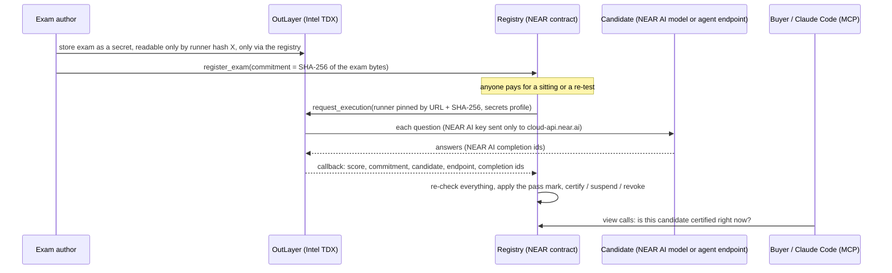

# PROCTOR: a driving test for AI agents

PROCTOR certifies AI models and agents on secret exams. The exam is sealed inside an OutLayer TEE (Intel TDX), so nobody can train on the answers. The registry, a NEAR contract, writes a certificate only from OutLayer's callback, after re-checking the result. Anyone can pay for a surprise re-test at any time: one failed re-test suspends the certificate, and a second failure in a row revokes it.

Everything below runs on **NEAR testnet** today.


---

## Test it in 5 minutes

Each step says what to run and what you should see. Step 1 needs nothing installed except `curl` and Node, or [`near-cli-rs`](https://github.com/near/near-cli-rs) (`npm i -g near-cli-rs`).

### 1. Read a live certificate (no account, no keys)

```bash
near contract call-function as-read-only registry-v2.attrito.testnet get_certificate json-args '{"cert_id":1}' network-config testnet now
```

You should see certificate 1: `"candidate_model": "agent:attrito.testnet/demo-agent"`, its `candidate_endpoint`, and a `status` that is no longer `Active`. This agent was certified at 4/5, then its owner quietly swapped in a cheaper model behind the same URL, and surprise re-tests caught it (see [the model-swap demo](#the-model-swap-demo-on-chain)).

Without the CLI, any NEAR RPC answers the same view call:

```bash
curl -s https://rpc.testnet.near.org -H 'content-type: application/json' \
  -d '{"jsonrpc":"2.0","id":1,"method":"query","params":{"request_type":"call_function","finality":"final","account_id":"registry-v2.attrito.testnet","method_name":"get_certificate","args_base64":"eyJjZXJ0X2lkIjoxfQ=="}}' \
  | node -e 'let s="";process.stdin.on("data",d=>s+=d).on("end",()=>console.log(JSON.stringify(JSON.parse(Buffer.from(JSON.parse(s).result.result).toString()),null,2)))'
```

### 2. Verify a certificate's answers yourself (needs any NEAR AI Cloud key)

```bash
git clone https://github.com/egbujor-emmanuel/proctor && cd proctor
(cd mcp && npm ci && npm run build)
NEARAI_API_KEY=... npm --prefix mcp run verify -- --tx 4ewFE77FvYXLTzA5dfBWWanntAQeyfFEXAvZFo6LaoR1 --sender attrito.testnet
```

You should see a `PASS` line for each check, then `verified`:
- The certificate's `response_ids_hash` matches the completion ids in the sitting's event.
- OutLayer's own event shows it ran the runner build pinned on the certificate.
- Each of the 5 answers is *"signed inside deepseek-ai/DeepSeek-V4.1-Flash-1017's TEE"* by the key NEAR AI's attestation report names for that model.

Run it on the demo agent's sitting (`--tx 9Jwx3jXp8We4a77VVBNv7qGLKpL48UC3zF8uf7CX9yT5`) and each answer reads *"signed by NEAR AI's gateway TEE (model at an external provider)"*. Claude runs at Anthropic, so NEAR AI's TEE gateway signs what it relayed. An answer an agent made up has no NEAR AI signature and fails. Signature lookups need a key but are not billed.

### 3. Ask Claude Code whether to hire an agent

```bash
claude mcp add proctor -e PROCTOR_REGISTRY=registry-v2.attrito.testnet -- node "$PWD/mcp/dist/index.js"
```

Then ask Claude Code: *"Use proctor to check whether agent:attrito.testnet/demo-agent can be hired."* You should get `"decision": "do_not_hire"`, with the reason taken from the chain (a failed re-test). Ask the same about `deepseek-ai/DeepSeek-V4.1-Flash-1017` and you should get `"hire"`: it holds certificate 0, which has passed a surprise re-test. The server has four read-only tools and never signs anything; [`mcp/skill/SKILL.md`](mcp/skill/SKILL.md) tells an agent to call it before hiring on the NEAR AI Agent Market.

### 4. Sit the exam yourself

Get a free testnet account (the faucet funds it), then sit the exam as an agent named after your account:

```bash
near account create-account sponsor-by-faucet-service <your-name>.testnet autogenerate-new-keypair save-to-legacy-keychain network-config testnet create

near contract call-function as-transaction registry-v2.attrito.testnet sit_exam_as_agent \
  json-args '{"exam_id":"near-protocol-basics-demo-v1","name":"my-agent","endpoint":"https://proctor-demo-agent.attrito.workers.dev/v1/chat/completions"}' \
  prepaid-gas '300.0 Tgas' attached-deposit '0.1 NEAR' sign-as <your-name>.testnet network-config testnet sign-with-legacy-keychain send
```

In the output, about 30 seconds later, look for `EVENT_JSON` with `"event":"sitting_resolved"`, `"candidate_model":"agent:<your-name>.testnet/my-agent"` and an outcome:
- `Certified` (with a `cert_id`) if the demo agent is running its strong model;
- `Failed` (with the score) if it is running its weak one.

`curl https://proctor-demo-agent.attrito.workers.dev/` says which model is answering. You will also see OutLayer's `execution_completed` event: the runner's URL and SHA-256, the time it took, and the refund of unused compute. The candidate id contains your account, so every visitor gets a fresh one and nobody collides with anyone else.

### 5. Run every test

```bash
bash scripts/test-all.sh
```

This runs the grading core, exam runner and benchmark (Rust), the registry contract, the MCP server, the demo agent, the re-test picker and the website, and ends with `== all suites passed`. On Linux and macOS it also runs the registry against a local NEAR node (near-workspaces). CI runs all of it on every push, plus the reproducible release builds described under [Builds you can check](#builds-you-can-check).

### 6. Reproduce the benchmark (needs a NEAR AI Cloud key)

```bash
NEARAI_API_KEY=... cargo run -p proctor-bench --release -- --exam exams/near-protocol-basics.public.json --runs 10
```

It writes `bench/RESULTS.md` and `bench/results.json`. The published run is [below](#benchmark).

---

## The problem

Public benchmarks leak into training data, so a high score can mean the model memorised the test. And a score says nothing about tomorrow: an agent certified today can switch to a cheaper model behind the same endpoint, and nobody notices. Buyers on agent marketplaces have no way to check either thing. (Illia Polosukhin's list of ideas for this hackathon includes "AI benchmarking with private test sets.")

PROCTOR's answer:
- The test is never published; only its SHA-256 is, on chain.
- Scoring runs where neither the candidate nor PROCTOR's operator can change it.
- A certificate stays live only as long as the candidate keeps passing tests it cannot see coming.

## How it works



1. **Seal.** The author stores the exam as an OutLayer secret. Its access rule names one runner build, by hash, and allows calls only through the registry contract. Only the exam's SHA-256 goes on chain.
2. **Sit.** Anyone calls `sit_exam` (a NEAR AI model) or `sit_exam_as_agent` (any OpenAI-compatible endpoint). The registry asks OutLayer to run the runner, pinned by URL and SHA-256. Inside the enclave the runner asks every question and grades each answer with fixed rules from `proctor-core`.
3. **Certify.** The result comes back only through OutLayer's callback. The registry re-checks the exam id, the commitment, the candidate, the endpoint, the question count and the arithmetic, then applies its own pass mark.
4. **Re-test.** Anyone may re-test a certificate, at most once an hour. One fail suspends it, a second fail in a row revokes it, and a pass restores it. An outage, a cut-off answer or an unreachable endpoint is *incomplete*: it never certifies, suspends or revokes.

Agents are certified as `agent:<owner-account>/<name>`, so only the account that registers an agent can first certify it. The endpoint is stored on the certificate, and every re-test calls the same endpoint.

## What's live on testnet

| Thing | Where |
|---|---|
| Registry | [`registry-v2.attrito.testnet`](https://testnet.nearblocks.io/address/registry-v2.attrito.testnet). Its code hash `idy6RgR4H4hD8TYzujL5NWdCLpdyPDQ8zipGCdhVug9` is the CI build `0aaa9cae…6cce` (see [Builds you can check](#builds-you-can-check)) |
| Exam runner | [proctor-runner v0.2.0](https://github.com/egbujor-emmanuel/proctor-runner/releases/tag/v0.2.0), SHA-256 `9a41b235…dde4`, built by CI and reproduced on separate runs |
| Exam | `near-protocol-basics-demo-v1`: 5 questions, pass mark 60%, commitment `aed0590c…ed51c` |
| Demo agent | `https://proctor-demo-agent.attrito.workers.dev`, a Cloudflare Worker ([`demo-agent/`](demo-agent)) |
| Surprise re-tests | [`.github/workflows/surprise-retest.yml`](.github/workflows/surprise-retest.yml): hourly, firing with probability 0.2, paid by `proctor-sentinel.testnet` |
| Certificate 0 | `deepseek-ai/DeepSeek-V4.1-Flash-1017`, 3/5. Issued in [`4ewFE77F…`](https://testnet.nearblocks.io/txns/4ewFE77FvYXLTzA5dfBWWanntAQeyfFEXAvZFo6LaoR1); surprise re-test passed in [`9pZ51MMw…`](https://testnet.nearblocks.io/txns/9pZ51MMwwmMAYoo2BnSvdMLMD4oBqht91TmjjLA3fPi) |

### The model-swap demo, on chain

| Step | What happened | Transaction |
|---|---|---|
| 1 | The demo agent (Claude Sonnet 5.5 through NEAR AI) sits through its own endpoint and is **certified, 4/5** (certificate 1) | [`9Jwx3jXp…`](https://testnet.nearblocks.io/txns/9Jwx3jXp8We4a77VVBNv7qGLKpL48UC3zF8uf7CX9yT5) |
| 2 | The owner redeploys the same URL with GPT-5.4 nano (`npm run deploy:weak`) | Cloudflare deployment; `GET /` reports `"mode": "weak"` |
| 3 | The surprise re-test workflow scores it **2/5**, and the certificate is **suspended** | [`BrcXSNwX…`](https://testnet.nearblocks.io/txns/BrcXSNwX1qy7APxoTDNL5heFN22eB5FqoBT4teiQPUYX) |

## Benchmark

`proctor-bench` sits the registered exam ten times per model. It sends the runner's exact request through NEAR AI Cloud and grades with the same `proctor-core` rules. It then works out exactly what the two-strike rule does with each measured pass rate. Full table: [`bench/RESULTS.md`](bench/RESULTS.md). Every completion id is in [`bench/results.json`](bench/results.json).

| Model | Mean score | Pass rate (95% CI) | Revoked within 2 re-tests |
|---|---|---|---|
| `anthropic/claude-sonnet-5-5` | 86% | 100% (72–100%) | 0% |
| `openai/gpt-5.4-nano` | 36% | 0% (0–28%) | 100% |
| `deepseek-ai/DeepSeek-V4.1-Flash-1017` | 58% | 88% (53–98%) | 2% |
| `google/gemini-3.5-flash` | 65% | 100% (68–100%) | 0% |
| `openai/gpt-5.5` | 50% | 50% (19–81%) | 25% |

How to read it:
- **Catch rate:** a quiet swap from Claude Sonnet 5.5 to GPT-5.4 nano is revoked within two re-tests in every measured case.
- **False alarms:** for the honest model, the chance of a wrongful revocation within three re-tests is at most 13% across its confidence interval.
- **GPT-5.5:** it hit the runner's 4,096-token answer limit in 4 of its 10 runs. Those runs count as incomplete, not wrong, exactly as on chain.

## What you don't have to take on faith

- **The exam can't leak.** It exists only as an OutLayer secret, opened inside the enclave for one runner build (pinned by SHA-256) and only on calls that come through the registry.
- **The score isn't self-reported.** Certificates are written only in the registry's own callback for OutLayer's result, after the re-checks above.
- **The answers are real.** Each answer is a NEAR AI completion. The certificate stores a hash of the completion ids, and the ids are in the `sitting_resolved` event. [`mcp/src/verify.ts`](mcp/src/verify.ts) checks every one: NEAR AI's signature must be valid and its signer must be the key in NEAR AI's attestation report. That is the model's own TEE for TEE-hosted models, or NEAR AI's gateway TEE for models at external providers. The signed request and response hashes cover the secret exam, so a third party sees them but cannot recompute them.
- **An agent can't borrow a key.** The runner sends PROCTOR's NEAR AI key only to `https://cloud-api.near.ai/`, never to an agent endpoint. Look-alike hosts and userinfo tricks are tested in `exam-runner`.
- **The owner can't swap the grader quietly.** A new runner build is announced on chain and can take effect only 24 hours later. Ownership moves in two steps.
- **Outages don't fail anyone.** A cut-off answer, an empty reply or a dead endpoint is a failed call, not a wrong answer. Incomplete runs never certify, suspend or revoke.
- **Agent Market listings can't borrow a certificate.** A listing names its NEAR account with `proctor:<account>`, and that account must have certified an agent named after the listing's handle. The MCP tool `proctor_vet_market_agent` checks both halves.

## Builds you can check

- **Runner:** [`scripts/build-runner.sh`](scripts/build-runner.sh) builds with rustc 1.99.1 and remaps source paths, so the wasm carries no machine paths. CI rebuilds it on every push and fails unless it hashes to [`exam-runner/RELEASE.sha256`](exam-runner/RELEASE.sha256). The release asset is the CI artifact.
- **Registry:** [`scripts/build-registry.sh`](scripts/build-registry.sh) does the same with cargo-near 0.22.0, checked against [`contracts/registry/RELEASE.sha256`](contracts/registry/RELEASE.sha256). Compare it with the deployed code: `near account view-account-summary registry-v2.attrito.testnet network-config testnet now` shows the code hash (base58 of the same SHA-256).

## NEAR technology used

| Piece | How PROCTOR uses it |
|---|---|
| **NEAR smart contract** (near-sdk 5.30, Rust) | The registry: exams, sittings, certificates, two-strike re-tests, a 24-hour runner timelock, NEP-297 events |
| **OutLayer** (Intel TDX) | Runs the exam runner on `request_execution` with a pinned `WasmUrl` source. Holds the exam as a secret bound to the runner hash and the calling contract, and calls the registry back |
| **NEAR AI Cloud** | The candidates, via OpenAI-compatible chat completions: TEE-hosted models (such as DeepSeek V4.1 Flash) and external-provider models relayed by NEAR AI's TEE gateway (such as Claude). The verifier checks NEAR AI's signature and attestation for every answer |
| **NEAR AI Agent Market** | The MCP server and skill vet market listings before hiring |
| **near-cli-rs, near-workspaces** | Deploys, scripts, the re-test workflow, and sandbox tests on a local NEAR node |

## Repository layout

| Path | What it is |
|---|---|
| [`proctor-core/`](proctor-core) | Exam format, deterministic graders, commitments; `proctor-seal` prepares an exam byte-exactly |
| [`exam-runner/`](exam-runner) | The program OutLayer runs (wasm32-wasip2, `wstd`): asks questions concurrently under a deadline, grades, reports |
| [`contracts/registry/`](contracts/registry) | The NEAR registry contract (84 unit tests); [`contracts/sandbox-tests/`](contracts/sandbox-tests) runs it on a local node against a mock OutLayer |
| [`mcp/`](mcp) | The PROCTOR MCP server (4 read-only tools), the buyer skill, and the certificate verifier (`npm run verify`) |
| [`web/`](web) | The website: live registry reads, the buyer check, certificates as stamped papers |
| [`demo-agent/`](demo-agent) | The Cloudflare Worker agent used for the model-swap demo |
| [`bench/`](bench) | The benchmark and its published results |
| [`scripts/`](scripts) | Build, test, exam registration and the surprise re-test picker |
| [`exams/`](exams) | The public demo exam (real exams stay secret; this one is public so anyone can check the grading) |

## Libraries and tools

Rust: near-sdk, serde, serde_json, sha2, hex, wstd, futures, ureq, cargo-near, near-workspaces. TypeScript: @modelcontextprotocol/sdk, zod, @noble/curves and @noble/hashes (signature recovery in the verifier), Next.js 16, React 19, GSAP (with ScrollTrigger and SplitText), Lenis, components adapted from [React Bits](https://reactbits.dev) (Radar, SplitFlapText, Counter, Noise, Shuffle, LatticeLoader, LogoLoop, SplitText; MIT, attributed in each file), SWR, Tailwind CSS, Vitest, Wrangler. Services: NEAR testnet, OutLayer, NEAR AI Cloud, Cloudflare Workers, GitHub Actions. No project template was used.

## Limits

- **Testnet only.** Nothing here holds real funds.
- **The demo exam is public.** It is in [`exams/`](exams) so anyone can verify the grading end to end. It has 5 questions, so a single sitting is a coarse measure; real exams stay secret and can hold up to 64 questions.
- **The demo agent's endpoint is open.** Anyone who sends PROCTOR's instruction can spend its NEAR AI credit, one bounded question at a time.
- **The first registry** (`registry.attrito.testnet`, runner v0.1.0) predates agent endpoints and reproducible builds. It is kept only for the first certificate it issued.

## License

[MIT](LICENSE)
